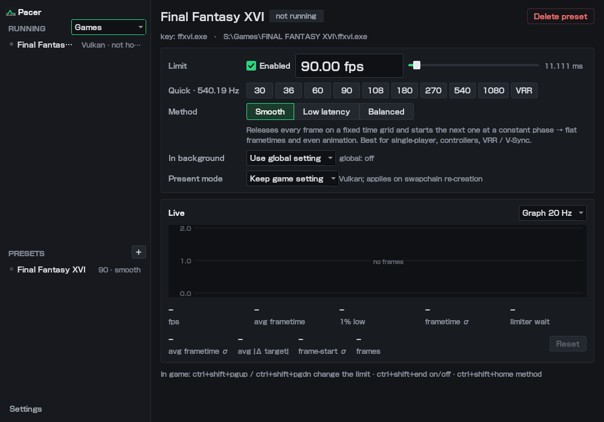

# Pacer

**A frame rate limiter for Linux games**, with per-game presets, a limit you can change in-game, and a choice
between perfectly flat frame pacing and minimum input latency. Think RTSS's limiter with a small, clean GUI.

## Features

- **Works with almost everything**: native Vulkan, Proton/Wine with DXVK (D3D9–11) and VKD3D-Proton (D3D12)
  are hooked automatically through an implicit Vulkan layer. Native OpenGL games are hooked via a launch wrapper.
- **Per-game presets**: pick a running game, set a limit, done. The preset is applied automatically every time
  that game starts, even when the GUI is closed.
- **Three limiting methods**:
  | Method | Where it waits | Best for |
  |---|---|---|
  | **Smooth** (frame pacing) | right before present, on a fixed absolute time grid; the next frame starts at a constant phase | flat frametimes; single-player, controllers, VRR/V-Sync |
  | **Low latency** (competitive) | right after present, so the game samples input as late as possible | shooters and other competitive games |
  | **Balanced** (predictive) | learns the frame's CPU time, sleeps after present and wakes just in time | near-Smooth pacing with lower latency |
- **Change the limit in-game** with hotkeys (cycling through refresh-rate-friendly values), with an on-screen
  indicator in Vulkan games.
- **Refresh-aware quick presets**: values that divide evenly into your display's refresh rate
  (540 Hz → 30, 36, 60, 90, 108, 180, 270, 540…), locked to the display's *exact* rate (e.g. 540.189 Hz) so
  divisors never drift.
- **Live frametime graph** and long-run statistics: average frametime σ, average deviation from target,
  frame-start σ (how evenly the game samples input), 1% lows.
- **Background limit**: lower the frame rate automatically while the game is not focused.
- 1–20000 FPS, 32- and 64-bit games, Steam/Faugus/Lutris/Heroic game titles, tray icon, start on login.

## Install

### Arch Linux / CachyOS

A `PKGBUILD` is included (AUR package coming soon):

    cd packaging && makepkg -si

### From source (per user, no root)

Dependencies: `g++` (with 32-bit multilib for 32-bit games), `make`, Vulkan headers, Python 3 and PySide6.

    git clone https://github.com/Kanasara/pacer && cd pacer
    make            # builds the 64-bit and 32-bit libraries
    ./install.sh    # installs into ~/.local
    pacer           # start the GUI (also in the app menu)

`./uninstall.sh` removes everything except your presets. Packagers: `PREFIX=/usr DESTDIR=… ./install.sh`.

| Game type | How it is hooked |
|---|---|
| Native Vulkan, Proton/Wine with DXVK or VKD3D-Proton | automatically (`VK_LAYER_PACER_limiter`); restart games that were already running |
| Native OpenGL | Steam launch option `pacer-run %command%` |

Disable the layer for a single game with the launch option `DISABLE_PACER=1 %command%`.

## Usage

1. Start the game. It appears under **Running** in the sidebar (the filter switches between *Games*,
   *Graphics apps* and *All processes*; right-click to pin or hide a program; **+** adds one by hand).
2. Select it and click **Create preset**. Type a limit or click a quick preset, then pick a method.
3. Changes apply to the running game immediately and are remembered for next time.

### In-game hotkeys

| Default | Action |
|---|---|
| Ctrl+Shift+PgUp / PgDn | next / previous limit (quick presets, a custom list, or a fixed step) |
| Ctrl+Shift+End | limiter on/off |
| Ctrl+Shift+Home | switch method |

Hotkeys can be recorded in **Settings → Hotkeys**. They are read inside the game through X11/XWayland
(covers Proton and most native games). For native-Wayland games, bind desktop shortcuts to:

    pacer-ctl up | down | toggle | on | off | set 72 | mode [smooth|latency|balanced] | status

## How it works

The Vulkan layer (and the OpenGL `LD_PRELOAD` hook) waits inside the present call using `clock_nanosleep`
followed by an adaptive busy-wait for the last stretch, with 1 ns timer slack. Each game reads its preset from
`~/.config/pacer/presets/<exe>.conf` and watches it for changes, so the GUI only edits files and never injects anything.
Live statistics are shared through a small memory-mapped file in `~/.local/state/pacer/run/`.

Limits above 1000 FPS work (up to 20000); how closely a game tracks them depends on how consistent its own frame
times are, and the final busy-wait keeps a CPU core busy for part of each frame.

## Privacy

Pacer has no telemetry. To show proper game titles it downloads one public file, Discord's list of known game
executables, on first run and then monthly, and converts it into a local index (`~/.cache/pacer`). Your process list
never leaves your PC. Turn this off in **Settings → Application → Game names**; titles then come from your Steam
library, Faugus/Lutris/Heroic and folder names.

## Files

- `~/.config/pacer/presets/<exe>.conf`: one preset per executable
- `~/.config/pacer/settings.conf`: hotkeys, OSD, defaults, ignore list, background limit, GUI options
- Debug output: `PACER_DEBUG=1`

## Development

    make dev        # libraries + headless test programs
    make test       # pacing test (CPU only), Python syntax, offscreen GUI layout test
    VK_IMPLICIT_LAYER_PATH=$PWD/build/dev-manifest build/tests/vk_smoke   # headless Vulkan + OSD (needs a GPU)
    bin/pacer-run build/tests/gl_smoke                                    # headless EGL hook check

## Support

If Pacer is useful to you, you can support development here:

## License

[MIT](LICENSE) © 2026 Kanasara
